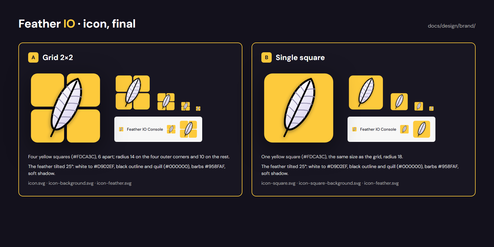
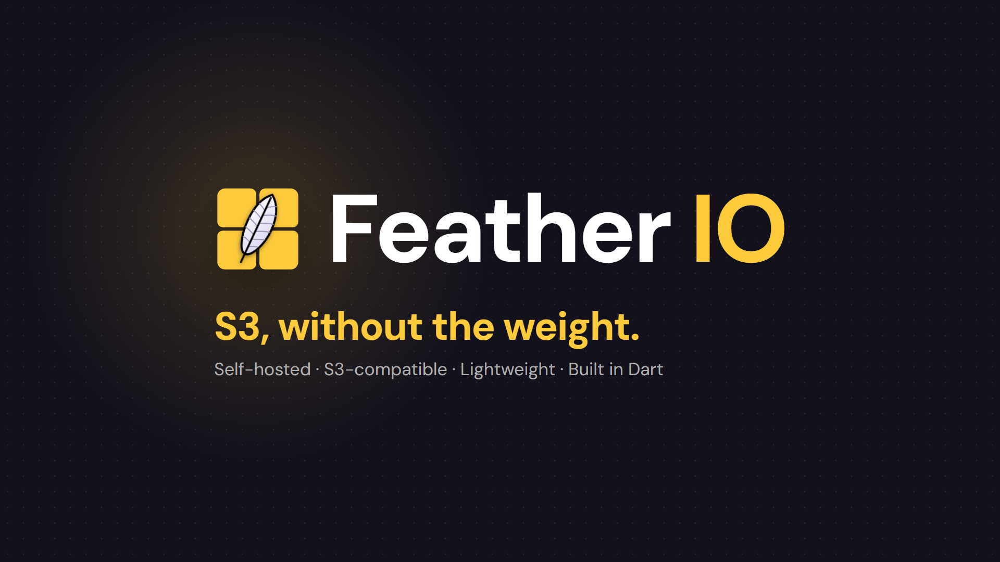
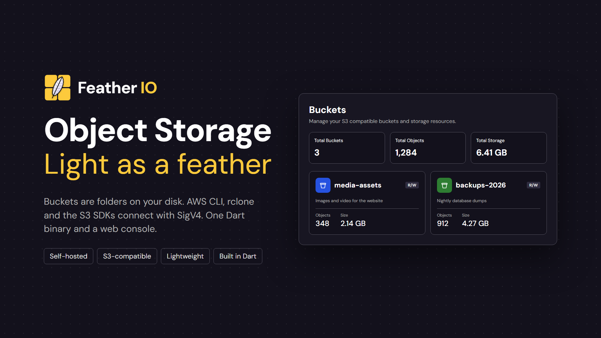
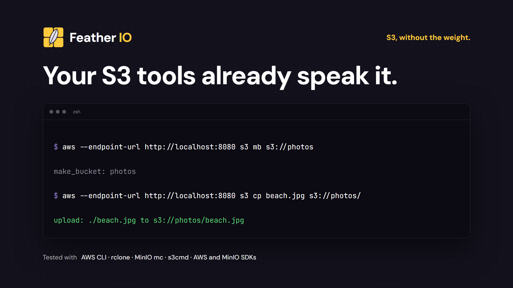
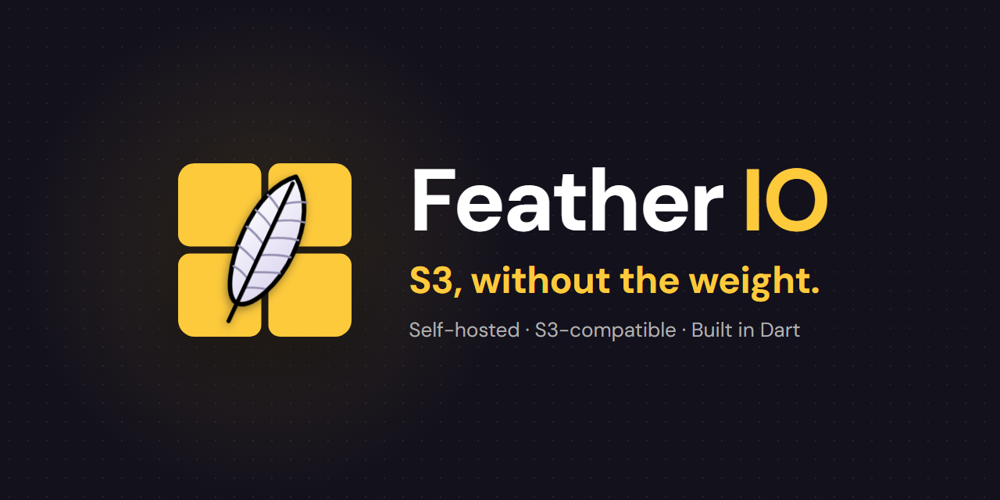

# The brand

The visual identity of Feather IO: the icon, its colors and type, and the images used to present
the project. Everything here comes from the Claude Design canvas "Feather IO Brand" and is exported
to [`design/brand/`](design/brand) (see [Keeping it up to date](#keeping-it-up-to-date)).



## The icon

A feather over yellow squares: object storage (the squares, the buckets and objects of a grid) that
weighs nothing (the feather). It is made for dark backgrounds, like the console's.

There are two versions, with the same feather and the same colors:

| Version               | Shape                                         | Use it for                                                                     |
|-----------------------|-----------------------------------------------|--------------------------------------------------------------------------------|
| **A · Grid 2×2**      | Four yellow squares, 2×2                      | The main icon: README, presentation images, the console, anywhere by default   |
| **B · Single square** | One yellow square, the size of the whole grid | Where the grid gets lost: app stores, launchers, very small sizes, round masks |

<p>
  
  &nbsp;&nbsp;
  
</p>

### Construction

Both are drawn on a 160 × 160 grid (the `viewBox` of the SVGs), with a margin of 6 on every side,
so the shapes span 6 → 154.

| Part              | Measures                                                                                                                 |
|-------------------|--------------------------------------------------------------------------------------------------------------------------|
| Squares (A)       | Four of 71 × 71, at 6 and 83 on each axis, **6 apart**                                                                   |
| Corner radius (A) | **14** on the four outer corners of the grid, **10** on every other corner (where two or four squares meet)              |
| Square (B)        | One of 148 × 148 at 6, 6, radius **18**                                                                                  |
| Feather           | Centered on the icon (80, 80), **tilted 25°** clockwise, in a box of 59.2 × 148 (`icon-feather.svg` keeps that position) |
| Feather, inside   | A leaf shape with a straight quill along its axis, 6 barbs on the right and 5 on the left, from the quill to the edge    |
| Shadow            | Under the feather only: offset 0, 3; blur 2 (`feDropShadow`); `#13111C` at 45 %                                          |

### Colors

| Element          | Color                 | Token                      | Notes                                               |
|------------------|-----------------------|----------------------------|-----------------------------------------------------|
| Squares          | `#FDCA3C`             | `secondary` (brand yellow) | The yellow of the console: the *IO* of the wordmark |
| Feather, fill    | `#FFFFFF` → `#D9D2EF` |                            | Linear gradient, top left to bottom right           |
| Feather, outline | `#000000`             |                            | Pure black, 2.4 units at the feather's scale        |
| Feather, quill   | `#000000`             |                            | Pure black, 2.2 units                               |
| Feather, barbs   | `#958FAF`             |                            | A muted violet, 1.1 units                           |
| Feather, shadow  | `#13111C` at 45 %     | `background1`              |                                                     |

The rest of the brand uses the palette of the console
([design system](https://claude.ai/artifact/1dJk7nhzEP7Y2CcgnTMyuB)):

| Use                           | Color     | Token           |
|-------------------------------|-----------|-----------------|
| Background of every image     | `#13111C` | `background1`   |
| Cards and panels              | `#181622` | `background2`   |
| Borders                       | `#575562` | `grey5`         |
| Main text                     | `#FFFFFF` | `white`         |
| Secondary text                | `#AFAFAF` | `grey3`         |
| Accent text (tagline, *IO*)   | `#FDCA3C` | `secondary`     |
| Soft violet (prompt, details) | `#9484C5` | `primary-faded` |

The images add a dot grid over the background (white at 7 %, every 30 px, like the console) and a
glow of the brand yellow behind the icon (`#FDCA3C` from 22 % to transparent).

### Files

In [`design/brand/`](design/brand), versioned as SVG; the PNGs are 1024 × 1024 with a transparent
background, rendered from them. Every SVG of an icon shares the 160 × 160 grid, so the background
and the feather laid one over the other give the whole icon.

| File                                                                                       | What it is                    |
|--------------------------------------------------------------------------------------------|-------------------------------|
| [`icon.svg`](design/brand/icon.svg) · [`.png`](design/brand/icon.png)                      | Icon A, whole                 |
| [`icon-background.svg`](design/brand/icon-background.svg) · `.png`                         | Icon A, only the four squares |
| [`icon-feather.svg`](design/brand/icon-feather.svg) · `.png`                               | The feather alone, in place   |
| [`icon-square.svg`](design/brand/icon-square.svg) · [`.png`](design/brand/icon-square.png) | Icon B, whole                 |
| [`icon-square-background.svg`](design/brand/icon-square-background.svg) · `.png`           | Icon B, only the square       |

### Using it

- Leave around the icon at least the gap of its margin scaled up (1/8 of its side) free of other
  elements.
- On a light background it works as it is (the feather keeps its black outline); on a busy photo,
  put it over a `background1` plate.
- Don't recolor the squares or the feather, rotate the icon, separate the feather from the squares
  in a lockup, or add effects other than its own shadow.
- Below 32 px prefer B: the gaps of the grid close up.

## The wordmark

**Feather IO** in DM Sans Bold, *Feather* in white and *IO* in the brand yellow, with a tight
letter spacing (about −3 % of the size). Next to the icon, the icon is a bit taller than the
capital *F* (×1.2) and sits 48 px from the text at 184 px.

| Text            | Font            | Color                                                            |
|-----------------|-----------------|------------------------------------------------------------------|
| Wordmark        | DM Sans Bold    | `#FFFFFF` + `#FDCA3C`                                            |
| Tagline         | DM Sans Bold    | `#FDCA3C`                                                        |
| Supporting line | DM Sans Regular | `#AFAFAF`                                                        |
| Code (terminal) | JetBrains Mono  | `#FFFFFF`, prompt `#9484C5`, output `#8A8996`, success `#5FD07C` |

**Tagline:** *S3, without the weight.* (alternatively *Object Storage — Light as a feather*).
**Supporting line:** *Self-hosted · S3-compatible · Lightweight · Built in Dart*.

## Presentation images

In [`design/brand/images/`](design/brand/images), on the dark background with the dot grid.

### Lockup



**1920 × 1080.** The icon and the wordmark, centered, with the tagline and the supporting line
aligned with the left edge of the icon. For the start of a talk, a video or a post.

### Product



**1920 × 1080.** *Object Storage / Light as a feather*, what it is in one sentence and four tags,
next to the *Buckets* screen of the console with example data.

### Terminal



**1920 × 1080.** *Your S3 tools already speak it.*: the AWS CLI creating a bucket and uploading a
file, and rclone listing it, against `localhost:8080`, with the clients it is tested with.

### GitHub social preview



**1280 × 640**, the size GitHub asks for. It is the image shown when the repository is shared.
GitHub doesn't read it from the repository: upload it in **Settings → General → Social preview**.

## Keeping it up to date

The canvas is the source: https://claude.ai/artifact/KeQUsAasyicZhB1xgijBaU ("Feather IO Brand").
When the brand changes, change the canvas, then:

1. Download its files into a folder, as the artifact serves them: `project/canvas.json` and
   `project/*.dc.html`.
2. If the icon changed, update its SVGs in `design/brand/` by hand (same 160 × 160 grid, the
   values of the canvas's `Icon` artboard) and the measures and colors above.
3. From the root of the repo, with Chrome and ffmpeg installed:

   ```bash
   python docs/design/tool/export_brand.py <that folder>
   ```

   It renders the icon and the SVG parts as PNG and the artboards listed in `BOARDS`
   (`images/`), and overwrites them.
4. Look at the result and commit it with the change.
